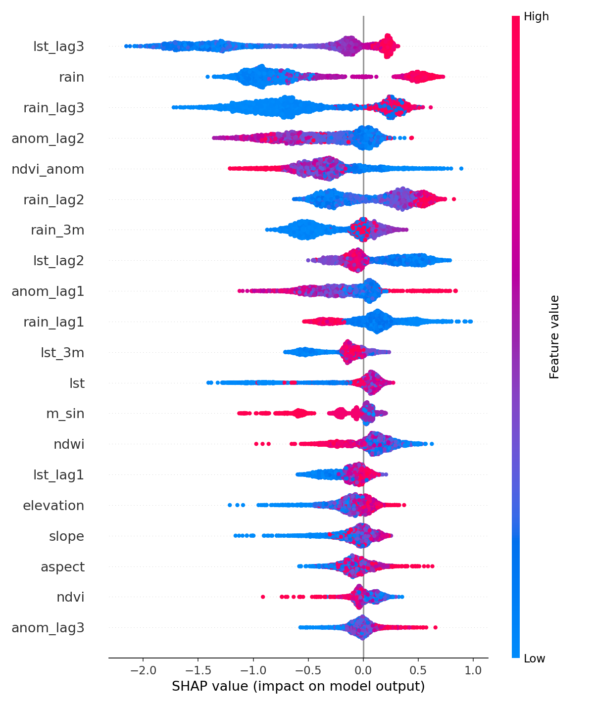
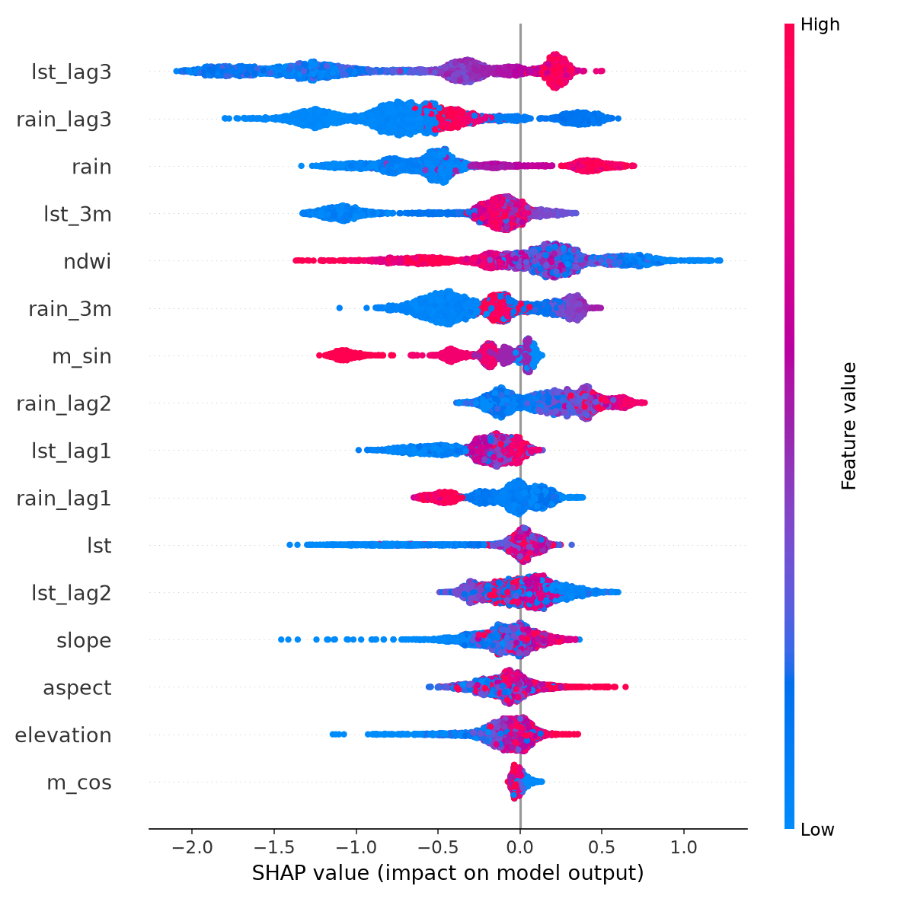

# 🌳 Amrabad Forest Vegetation Loss Risk Prediction

A machine learning pipeline that predicts **which forest pixels in the Amrabad region are likely to experience vegetation stress 2 months ahead**, using satellite and climate data collected through Google Earth Engine (GEE). The project combines time-series feature engineering, XGBoost classification, Explainable AI (SHAP), and an interactive Streamlit dashboard for forest monitoring.

## Problem Statement

Forest degradation is often detected after vegetation damage has already occurred. This project aims to forecast potential vegetation stress two months in advance, helping forest departments identify vulnerable areas and prioritize field inspections and monitoring.

## Highlights

- Monthly satellite and environmental time series (2023–2026) for the Amrabad Forest Region.
- Data collected using Google Earth Engine.
- Reconstructed pixel × month time series with missing-value handling and interpolation.
- Two-month-ahead vegetation stress prediction using future NDVI anomaly below −1 SD.
- Temporal train/validation/test split (2023–2024 / 2025 / 2026).
- Comparison of Logistic Regression, XGBoost, and persistence baseline.
- Ablation study comparing models with and without NDVI features.
- SHAP-based global and pixel-level model explanations.
- Pixel-level vegetation-loss risk scores.
- Streamlit dashboard for interactive forest-risk monitoring.

## Project Pipeline

Google Earth Engine Data Collection
              ↓
     Data Cleaning & Gap Filling
              ↓
        Feature Engineering
              ↓
    Future Vegetation Loss Labels
              ↓
       Temporal Data Splitting
              ↓
  Logistic Regression (Baseline)
              ↓
          XGBoost
              ↓
       Model Evaluation
              ↓
      SHAP Explainability
              ↓
       Risk Prediction
              ↓
     Risk Maps & Dashboard

## Study Area

**Amrabad Forest Region, Telangana, India**

The project uses satellite-derived vegetation indices and environmental variables to monitor potential vegetation stress across forest pixels.

## Dataset and Data Sources

| Variable | Description | Data Source |
|---|---|---|
| NDVI | Normalized Difference Vegetation Index | Google Earth Engine |
| NDVI Anomaly | Deviation from baseline vegetation condition | Derived from NDVI |
| NDWI | Normalized Difference Water Index | Google Earth Engine |
| Rainfall | Monthly precipitation | Google Earth Engine |
| LST | Land Surface Temperature | Google Earth Engine |
| Elevation | Terrain elevation | SRTM |
| Slope | Terrain steepness | Derived from SRTM |
| Aspect | Terrain orientation | Derived from SRTM |
| Latitude & Longitude | Pixel geographic coordinates | Derived spatial features |

**Data period:** 2023–2026

**Raw export:** `data/amrabad_2023_2026raw.csv`

## Data Preprocessing

- Loaded satellite and environmental data exported from GEE.
- Created monthly date columns.
- Replaced infinite values with missing values.
- Reconstructed a complete pixel × month time-series grid.
- Filled short missing gaps using interpolation.
- Removed pixels with excessive missing data.
- Restored static geographical features.

### Dataset Statistics

| Metric | Value |
|---|---:|
| Total unique pixels | 602 |
| Total raw observations | 27,069 |
| Missing data before filling | 4.3% |
| Pixels retained | 602 / 602 |
| Training observations | 14,448 |
| Validation observations | 7,224 |
| Testing observations | 3,612 |
| Future prediction observations | 1,204 |

### Positive-Class Distribution

| Dataset | Positive Rate |
|---|---:|
| Training (2023–2024) | 13.0% |
| Validation (2025) | 7.9% |
| Testing (2026) | 9.6% |

## Feature Engineering

### Static Features
- Elevation
- Slope
- Aspect
- Latitude
- Longitude

### Lag Features
Created 1-month, 2-month, and 3-month lag features for:
- Rainfall
- Land Surface Temperature
- NDVI Anomaly

### Rolling Features
- 3-month cumulative rainfall
- 3-month average temperature

### Seasonal Features
- Month sine transformation
- Month cosine transformation

These features help the model capture temporal trends, environmental changes, and seasonal vegetation patterns.

## Label Creation

The project uses a **2-month prediction horizon**.

Future NDVI anomaly is calculated using temporal shifting.

Binary classification labels:

- **1:** Future vegetation stress (NDVI anomaly below −1 SD).
- **0:** Stable vegetation.

This allows the model to learn relationships between current environmental conditions and future vegetation stress.

## Model Development

The following models were evaluated:

1. Persistence Baseline
2. Logistic Regression
3. XGBoost with all features
4. XGBoost without NDVI features (external environmental features only)

Class imbalance was addressed using XGBoost's `scale_pos_weight` parameter.

## Model Evaluation Results

Evaluation was performed on the held-out **2026 test dataset**.

**Positive-class prevalence: 9.6%**

| Model | PR-AUC | ROC-AUC | F1 Score | Recall |
|---|---:|---:|---:|---:|
| Persistence Baseline | 0.127 | 0.536 | 0.171 | 0.165 |
| Logistic Regression | 0.117 | 0.594 | 0.141 | 0.174 |
| XGBoost (External Features Only) | **0.214** | **0.774** | **0.334** | **0.794** |
| XGBoost (All Features) | 0.205 | 0.731 | 0.255 | 0.278 |

### Validation Results – 2025

| Model | PR-AUC | ROC-AUC | F1 Score | Recall |
|---|---:|---:|---:|---:|
| XGBoost | 0.117 | 0.572 | 0.168 | 0.173 |
| Logistic Regression | 0.086 | 0.509 | 0.132 | 0.567 |

### Key Findings

- XGBoost with external environmental features achieved the best test performance, with a PR-AUC of **0.214**, ROC-AUC of **0.774**, F1 score of **0.334**, and recall of **0.794**.
- The model without NDVI features outperformed the all-feature model, suggesting that rainfall, temperature, terrain, and their temporal patterns provide useful predictive information beyond vegetation-index history.
- The best model achieved a PR-AUC approximately 2.23 times the positive-class prevalence of 0.096.
- The results demonstrate promising predictive signal, although further spatial and ground-truth validation is required.

## Explainable AI (SHAP)

SHAP (SHapley Additive Explanations) is used to understand how individual environmental features influence the model's predictions.

| All Features | External Features Only |
|---|---|
|  |  |

SHAP provides:
- Global feature importance.
- Feature contribution to high-risk predictions.
- Individual pixel-level explanations.
- Insights into the influence of environmental and vegetation variables.

*The most influential features and their effects should be described here based on the actual generated SHAP plots.*

## Vegetation Risk Prediction

The trained XGBoost model generates a risk score for each forest pixel.

Risk categories:

- Low
- Moderate
- High
- Very High

Predictions are stored in:

`outputs/risk_predictions.csv`

### Risk Category Statistics

| Risk Category | Mean Predicted Score | Pixel-Month Records |
|---|---:|---:|
| Low | 0.0497 | 2,415 |
| Moderate | 0.1631 | 613 |
| High | 0.1739 | 253 |
| Very High | 0.2447 | 331 |

### Monthly Risk Distribution

| Month | Low | Moderate | High | Very High |
|---|---:|---:|---:|---:|
| July 2026 | 293 | 192 | 92 | 25 |
| August 2026 | 539 | 60 | 3 | 0 |

The predicted risk distribution indicates spatial and temporal variation in potential vegetation stress across the study area.

## Interactive Dashboard

The Streamlit dashboard provides an interface for exploring vegetation-loss risk predictions at the pixel level.

Features include:
- Vegetation risk visualization.
- Pixel-level risk scores.
- Risk category distribution.
- Environmental feature exploration.
- SHAP-based explanations.

## How to Run

git clone https://github.com/poojithaboddula42/amrabad-vegetation-risk.git

cd amrabad-vegetation-risk

pip install -r requirements.txt

python src/pipeline.py

streamlit run app.py

## Limitations

- **Short time series:** Approximately 3.5 years of monthly observations limits the reliability of long-term climatological estimates.
- **NDVI-derived labels:** The prediction target is based on future NDVI anomalies, so vegetation-index features can introduce temporal autocorrelation.
- **Spatial autocorrelation:** The current evaluation uses temporal splitting. Neighbouring pixels may be correlated, potentially making performance estimates optimistic.
- **Class imbalance:** Positive vegetation-stress observations are relatively uncommon.
- **Probability calibration:** Predicted risk scores should be interpreted as model scores, not calibrated probabilities.
- **Ground-truth validation:** Predictions have not yet been validated against field-observed vegetation loss.

## Future Enhancements

- Spatial block cross-validation.
- Probability calibration and threshold optimization.
- Longer historical satellite time series.
- Integration of fire occurrence and soil moisture data.
- Improved spatial visualization.
- Public deployment of the Streamlit dashboard.
- Validation against field observations.

## Tech Stack

Python · Google Earth Engine · Pandas · NumPy · Scikit-learn · XGBoost · SHAP · Streamlit · Geospatial Analysis

